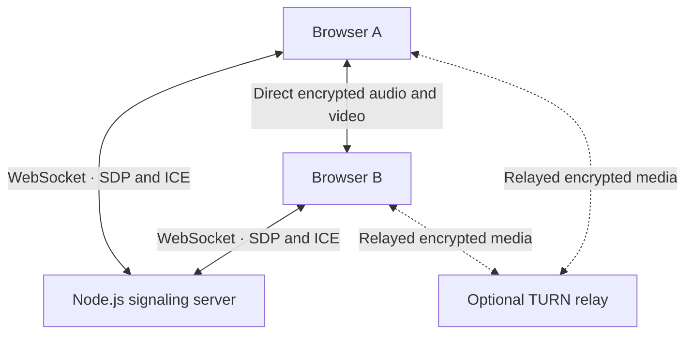

# Tandem

**Peer-to-peer video calls for up to four people, built with WebRTC.** Create a room, share an invite link, and join from a browser. Guests can join with the camera and microphone off and turn either on during the call.

Tandem uses a full mesh. Each browser opens an `RTCPeerConnection` to every other participant. A small Node.js server coordinates room membership and WebSocket signaling. WebRTC carries encrypted audio and video directly between browsers when the network allows it, with optional TURN relay for restrictive networks.

## Run locally

Requires Node.js 22.12 or newer and npm.

```bash
git clone https://github.com/adityaanilraut/tandem-webrtc.git
cd tandem-webrtc
npm ci
npm run dev
```

Open [Tandem on localhost](http://localhost:5173), select **Create a call**, and open the invite in a second browser window on the same computer. Use headphones to prevent audio feedback. Vite serves the React app and proxies `/api` and `/ws` to the local Node server.

### Share a call across devices

Install `cloudflared`, then run the public entry point. On macOS, install it with `brew install cloudflared`. [Cloudflare installation guide](https://developers.cloudflare.com/tunnel/get-started/quick-tunnels/#prerequisites)

```bash
npm run public
```

Open the printed `trycloudflare.com` HTTPS URL, select **Create a call**, and share the room invite with up to three guests. Guests open the link in their browser, choose their devices, and select **Join call**. Cloudflare supplies the HTTPS certificate. Keep the process running and the host computer awake. The temporary hostname changes when you restart. [Cloudflare Quick Tunnels](https://developers.cloudflare.com/tunnel/get-started/quick-tunnels/)

The tunnel carries the app, API, and WebSocket traffic. Audio and video follow the path each pair negotiates with WebRTC. If the page loads but callers cannot see or hear one another across networks, try [the TURN setup below](#configure-turn-for-restrictive-networks).

## How the WebRTC mesh works

The diagram shows the signaling and media paths for one pair. A four-person call has six peer pairs. Each participant sends media separately to the other three, so upload and encoding work grow with the room size.



1. **Join the room.** The Node server admits the browser over WebSocket, assigns it a participant ID, and sends the current roster. The signaling server forwards messages to specific peers within the room.
2. **Negotiate each connection.** For every new pair, the earlier participant sends the Session Description Protocol (SDP) offer and the newcomer answers. This rule prevents competing offers during simultaneous joins. Browsers exchange Interactive Connectivity Establishment (ICE) candidates as they discover them and queue incoming candidates until the remote description is set.
3. **Find a media path.** ICE checks candidate pairs. STUN helps a browser discover its public-facing address for a direct path. TURN provides a relay path when direct connectivity fails. Each pair negotiates its own path, so one connection can use TURN while another connects directly. [WebRTC peer connections](https://webrtc.org/getting-started/peer-connections)
4. **Keep connections while changing devices.** The initial offer negotiates audio and video transceivers even when both devices start off. Tandem uses `RTCRtpSender.replaceTrack()` when the caller enables or switches a device. A departure or media failure closes only the affected peer connections.

Rooms live in memory. An unused invite expires after ten minutes. The last caller can end the room by selecting **Leave**. If the last caller disconnects unexpectedly, the link stays usable for one minute. In a room with space, anyone with the invite can join, so share it with the intended participants.

### Where to read the code

| File | Responsibility |
| --- | --- |
| [`src/peerMesh.ts`](src/peerMesh.ts) | Peer connections, ordered SDP and ICE handling, and track replacement |
| [`src/useCall.ts`](src/useCall.ts) | Media capture, connection lifecycle, and rejoining |
| [`server/app.ts`](server/app.ts) | Room API, participant admission, and WebSocket signaling |
| [`server/ice.ts`](server/ice.ts) | STUN configuration and optional TURN credentials |
| [`shared/protocol.ts`](shared/protocol.ts) | Signaling message types and room limits |

## Configure TURN for restrictive networks

A fresh setup uses `stun:stun.l.google.com:19302` for direct calls. Set `STUN_URL` to use a different STUN server. Some cellular networks, VPNs, and firewalls require a TURN relay. Copy the configuration template locally and choose one credential method.

```bash
cp .env.example .env.local
```

| TURN provider | Variables in `.env.local` |
| --- | --- |
| Cloudflare Realtime TURN | `CLOUDFLARE_TURN_KEY_ID`, `CLOUDFLARE_TURN_API_TOKEN` |
| Provider with a username and password | `TURN_URLS`, `TURN_USERNAME`, `TURN_PASSWORD` |
| coturn with a shared secret | `TURN_URLS`, `TURN_SECRET` |

See the examples in [`.env.example`](.env.example). For Cloudflare, create a TURN key in the dashboard and supply its ID and API token. Cloudflare and coturn shared-secret modes issue one-hour credentials when a caller joins. For public calls that use these credentials, plan to finish within that hour. [Cloudflare TURN credentials](https://developers.cloudflare.com/realtime/turn/generate-credentials/)

To verify your relay, set `ICE_TRANSPORT_POLICY=relay` in `.env.local`, restart Tandem, and check two-way audio and video across separate networks. Restore `ICE_TRANSPORT_POLICY=all` for regular calls so ICE can consider direct and relay paths. Keep provider secrets in server-side variables outside the `VITE_` namespace. Git ignores `.env.local`.

## Run behind a stable HTTPS address

Put the built app behind an HTTPS reverse proxy or named Cloudflare Tunnel that forwards HTTP and WebSocket upgrades to Node. Set `PUBLIC_ORIGIN` to the exact origin your callers open.

```bash
npm run build
PUBLIC_ORIGIN=https://call.example.com npm start
```

The server defaults to `127.0.0.1:3002`. Set `HOST` and `PORT` for your deployment as needed. Set `CLIENT_IP_HEADER` only when a trusted proxy overwrites that header. Tandem serves the built app, room API, and WebSocket endpoint from the same origin.

## Test the mesh

```bash
npm test
npm run build
npx playwright install chromium
npm run test:browser
```

The unit and integration tests cover room admission, addressed signaling, ICE configuration, and peer lifecycle behavior. The Playwright test uses independent Chromium contexts and synthetic cameras and microphones. It verifies decoded video and received audio across all six WebRTC pairs, plus late joins, device switching, and rejoining. It writes screenshots to `artifacts/`.

For a real-device check, use the public HTTPS invite with desktop Chrome and iPhone Safari. Turn Wi-Fi off on the phone to test a separate network, then verify moving video and intelligible audio in both directions. Repeat with relay-only mode if you configured TURN.

## Troubleshooting

| Symptom | What to check |
| --- | --- |
| The invite opens on the host only | Use the HTTPS URL from `npm run public` for guests on other devices. |
| The page loads but the call stays connecting | Configure TURN and use relay-only mode to confirm the relay works. |
| The phone cannot open the public page | Use the latest printed URL and keep the host computer awake. |
| Safari joins but audio stays silent | Tap **Tap to play video & audio** if it appears, then check system volume and audio routing. |

<details>
<summary>Local HTTPS over Wi-Fi with mkcert</summary>

1. Connect the computer and iPhone to the same normal Wi-Fi network. Guest networks with client isolation may block peer-to-peer traffic.
2. Install mkcert. On macOS, use Homebrew. [mkcert setup](https://github.com/FiloSottile/mkcert)

   ```sh
   brew install mkcert
   ```

3. Stop the dev server, then generate the local HTTPS certificates.

   ```sh
   npm run setup:https
   ```

   The script installs a development CA into the computer’s trust store (macOS may ask for your password), generates a server certificate for localhost and the computer’s current LAN addresses, and copies **only the public CA certificate** to `.certs/tandem-rootCA.crt`. Certificates are ignored by Git. The CA private key stays in mkcert’s system directory.

4. Run `npm run setup:iphone`, then open its printed **HTTP address on port 5174 in iPhone Safari**. Tap **Download certificate**, allow the profile download, and install it in **Settings → General → VPN & Device Management** (or **Profile Downloaded**). This temporary setup page serves only the public certificate and instructions; it cannot serve private keys or other project files. Stop it with Ctrl+C after setup. Alternatively, AirDrop `.certs/tandem-rootCA.crt` to the iPhone.
5. On the iPhone, go to **Settings → General → About → Certificate Trust Settings** and enable full trust for this development CA. [Apple’s certificate trust instructions](https://support.apple.com/en-us/102390)
6. Restart the app.

   ```sh
   npm run dev
   ```

7. Open the printed `https://YOUR-LAN-IP:5173` address in desktop Chrome. Create a call, then copy the invite. HTTPS-mode invites automatically use the LAN address even when the computer opened localhost.
8. Open that invite in **Safari on the iPhone**. Enable camera/microphone access and join on both devices. Keep Safari open and the screen awake while calling. If playback is blocked, tap **Tap to play video & audio**.

Only share `tandem-rootCA.crt`; never share `rootCA-key.pem` or `dev-key.pem`. After testing, remove the profile from the iPhone’s **VPN & Device Management** settings. To remove the development CA from the computer’s trust store, run `mkcert -uninstall` (this can also affect other local projects using that CA). Remove `.certs` to return this project to localhost HTTP mode, then restart the dev server.

If certificate generation needs to happen before the computer’s administrator is available, run `npm run setup:https -- --no-install`. This generates the HTTPS certificates without adding trust to the computer. Complete computer trust afterward by running `mkcert -install` in your own Terminal and entering any administrator password locally. iPhone trust remains a separate manual step.

If your LAN IP changes, rerun `npm run setup:https` and restart the server. You only need to install the iPhone CA profile again if the CA itself changes. When VPNs or multiple network adapters cause the wrong invite address, set `LAN_HOST` to your Wi-Fi IP for both commands.

```sh
LAN_HOST=192.168.1.25 npm run setup:https
LAN_HOST=192.168.1.25 npm run dev
```

</details>
